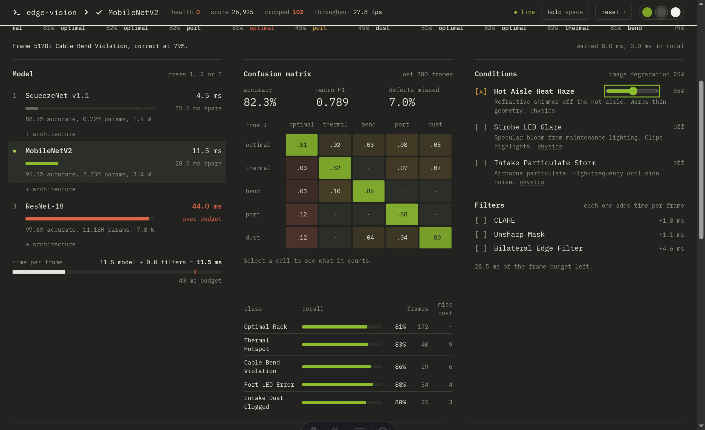
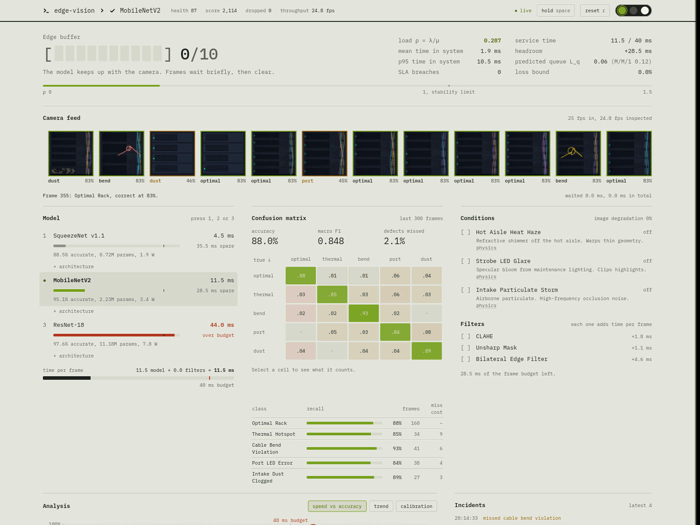
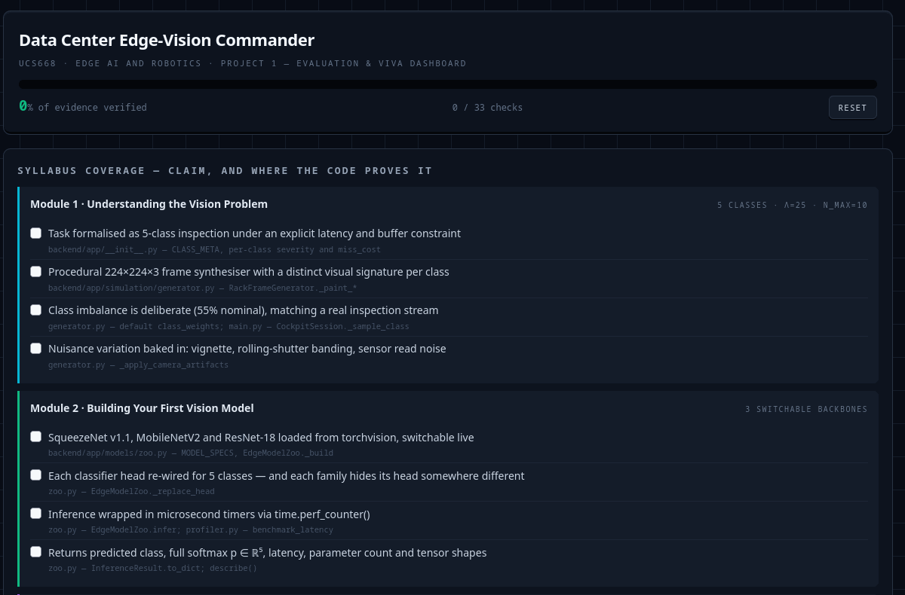
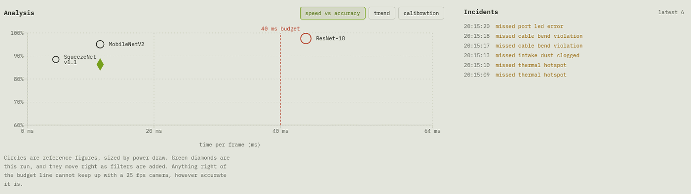
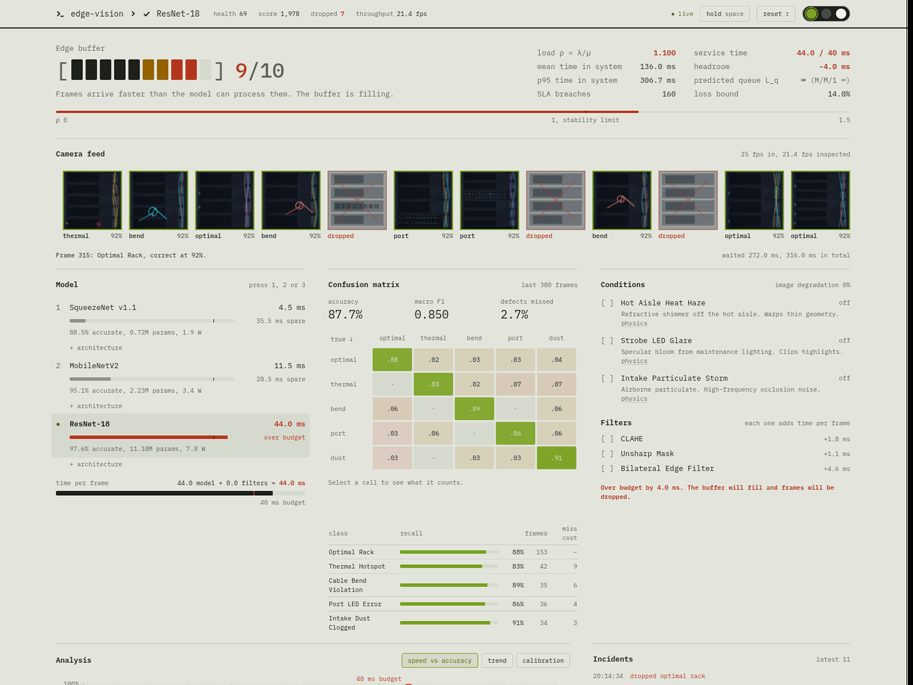
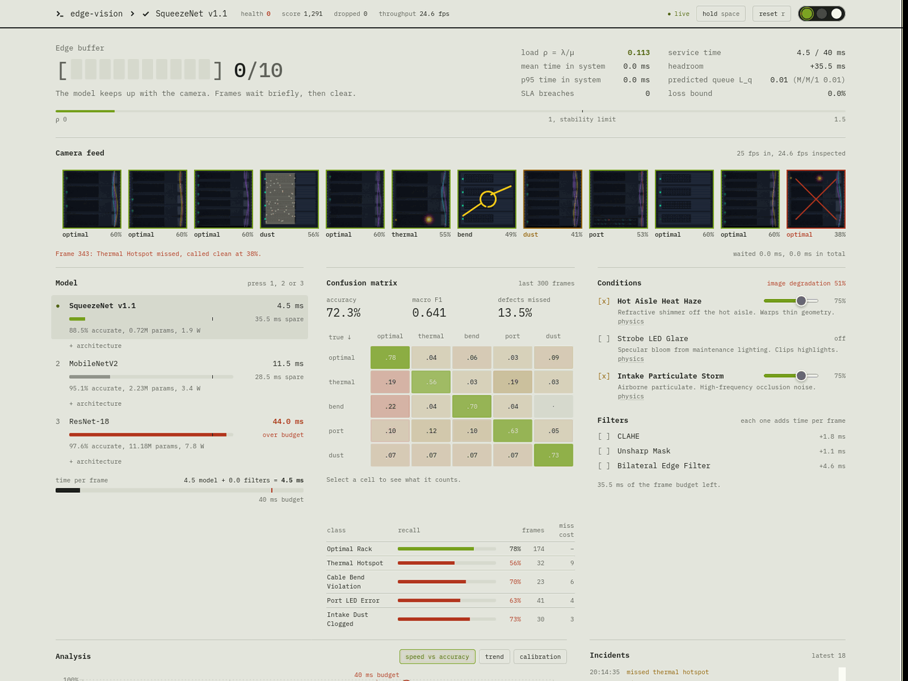

# Data Center Edge-Vision Commander

### The Latency vs. Accuracy Simulator

**UCS668 — Edge AI and Robotics: Data Center Vision** · Project 1
Thapar Institute of Engineering & Technology

A real-time mission-control cockpit for the central trade-off in edge computer
vision: **a model is not a system, and the most accurate model can be the one
that fails.**



<details>
<summary>Click to view Paper / Light theme capture</summary>



</details>

---

## Contents

- [The argument](#the-argument)
- [Quick start](#quick-start)
- [What you are looking at](#what-you-are-looking-at)
- [The three failure modes, on screen](#the-three-failure-modes-on-screen)
- [What is measured, and what is modelled](#what-is-measured-and-what-is-modelled)
- [Repository layout](#repository-layout)
- [The five inspection classes](#the-five-inspection-classes)
- [The inspection crew](#the-inspection-crew)
- [HTTP and WebSocket API](#http-and-websocket-api)
- [Engineering notes](#engineering-notes)
- [Demo script](#demo-script)
- [A note on the reported parameter counts](#a-note-on-the-reported-parameter-counts)

---

## The argument

A rail-mounted inspection camera in a hyperscale aisle emits frames at **25
FPS** — one every **40 ms**. The edge compute module has one worker and a
finite **10-frame buffer**. Each frame costs `T_service = T_infer + T_preprocess`.

**ResNet-18** classifies rack defects at 97.6%. It is also a failure. At 44 ms
per inference it serves 22.7 frames per second against a 25 FPS camera, so the
load factor `ρ = λ/μ = 1.10`, the backlog grows without bound, and the buffer
starts discarding frames. Those racks are never inspected by anything. Accuracy
measured only on the frames a model actually sees is not accuracy — it is a
survivorship statistic.

**SqueezeNet v1.1** runs in 4.5 ms and never queues. But its capacity cannot
hold the representation needed for a fiber bend under heat haze, so its
false-negative rate spikes under distribution shift. It drops nothing and misses
plenty — the same racks go uninspected, by a different mechanism.

**MobileNetV2** sits at 11.5 ms, leaving 28.5 ms of headroom in the budget —
enough to deploy a preprocessing kernel when a storm hits and *still* make the
deadline. That headroom is the engineering answer.

---

## Quick start

```bash
git clone https://github.com/PartheCraftyboy/DATA_CEN_UCS668.git
cd DATA_CEN_UCS668
```

> Cloning over SSH instead: `git clone git@github.com:PartheCraftyboy/DATA_CEN_UCS668.git`

Two processes: a Python backend that runs the real networks, and an Astro
frontend that draws the cockpit. **Run them in two terminals.**

### 1. Backend — edge vision core

```bash
cd backend
python -m venv .venv && source .venv/bin/activate     # Windows: .venv\Scripts\activate
pip install -r requirements.txt
uvicorn app.main:app --reload --port 8000
```

CPU-only PyTorch is intentional: an inspection rover has no datacenter
accelerator, and the whole argument depends on that.

| Optional | Effect |
|----------|--------|
| `pip install opencv-python-headless` | Preprocessing kernels run 10–40× faster. The code degrades gracefully to NumPy/SciPy without it, and the queue is charged the same *reference* cost either way, so the simulation behaves identically — see [Engineering notes](#engineering-notes). |
| `DCV_PRETRAINED=1 uvicorn app.main:app` | Downloads ImageNet weights. Improves the realism of the feature statistics and changes nothing else. |

### 2. Frontend — cockpit

```bash
cd frontend
npm install
npm run dev          # → http://localhost:4321
```

Point it at a non-default backend with `PUBLIC_WS_URL=ws://host:8000/ws`.

### 3. Evaluation dashboard

```bash
python sync_tracker.py --stats     # verifies every claim in track.html against the source
xdg-open track.html                # viva prep: rubric map, demo script, Q&A
```

`track.html` is a single self-contained file with no build step and no network
dependencies — it opens by double-clicking on any machine.

[](track.html)

### Keyboard

`1` SqueezeNet · `2` MobileNetV2 · `3` ResNet-18 · `SPACE` hold · `R` reset

### If the backend is not running

The cockpit falls back to an in-browser mirror of the same simulation and badges
itself **SIMULATED** rather than **LIVE**. The M/D/1 queueing demonstration
works identically, so a broken venv five minutes before the viva is survivable.

---

## What you are looking at

The screenshot at the top of this page is one run, mid-flight. Reading it
clockwise from the top left:

| Panel | What it shows |
|-------|---------------|
| **Edge buffer** | The 10-slot queue, live. The sentence underneath says in plain English what the number means. |
| **Queue theory** | `ρ = λ/μ`, mean and p95 time in system, SLA breaches, and the closed-form Pollaczek–Khinchine prediction next to the observed value. |
| **Camera feed** | The conveyor of synthesised rack frames at 25 FPS, each tagged with the predicted class and confidence. Dropped frames are struck out in red. |
| **Model** | The three backbones with measured latency, parameters and power. The bar shows how much of the 40 ms budget each one eats. |
| **Confusion matrix** | Live 5×5, row-normalised over a 300-frame window, so the diagonal reads as recall. |
| **Conditions / Filters** | Three environmental storms and three preprocessing kernels. Every kernel costs real milliseconds against the same budget. |
| **Analysis** | Speed-vs-accuracy Pareto frontier, running trend, and a calibration diagram. |
| **Incidents** | A rolling log of what was just missed or dropped, with timestamps. |



---

## The three failure modes, on screen

### 1. The accurate model that drops frames

Press `3`. ResNet-18 is the most accurate backbone available and it is the one
that breaks the system: `ρ` climbs to **1.100**, the buffer fills to 9/10,
frames are struck out of the conveyor, and the incident log fills with racks
that were never looked at.



Note the numbers that move together: `service time 44.0 / 40 ms`, `headroom
-4.0 ms`, `predicted queue L_q = ∞`, `loss bound 14.0%`. A 97.6% model that
discards a seventh of its input is not a 97.6% system.

### 2. The fast model that misses defects

Press `1` and turn on two storms. SqueezeNet drops **nothing** — buffer 0/10,
`ρ = 0.113` — and is still failing: image degradation hits 51%, macro-F1
collapses from 0.85 to **0.641**, thermal-hotspot recall falls to 56%, and the
same racks go uninspected by a different mechanism.



### 3. The one with room to spare

Press `2`. MobileNetV2 costs 11.5 ms and leaves **28.5 ms** of the frame budget
unspent — enough to deploy the bilateral kernel (+4.6 ms) when a storm hits and
still make the deadline. That is the whole answer, and it is visible as a bar.

---

## What is measured, and what is modelled

This distinction is the first thing an examiner should be told, because the
honest answer is the better answer.

**Measured** — real PyTorch, real CPU, real wall clock:

- Parameter counts, iterated from the live `nn.Parameter` set
- MAC / FLOP counts, from forward hooks on real tensor shapes
- The layer-by-layer spatial cascade (224 → 112 → 56 → 28 → 14 → 7)
- Inference latency, via `perf_counter()` around a genuine forward pass
- Preprocessing kernel cost, from real filter execution

**Modelled** — a documented decision model, not a trained classifier:

- Which class the backbone predicts, and with what confidence.

The backbones carry ImageNet (or random) initialisation and have **not** been
fine-tuned on labelled rack photography — no such dataset exists for this lab,
and an untrained 5-way head emits uniform noise, which would make the confusion
matrix a meaningless grey square.

So the zoo runs the real network — paying the real latency, which is the
quantity the entire queueing argument depends on — and resolves the *label*
through `CapacityDecisionModel`: a class-conditional confusion kernel whose
diagonal dominance is a function of the backbone's representational capacity and
the current storm severity. The real logits are folded in as the entropy source,
so the decision still varies with the actual pixels.

Latency is real. Accuracy degrades with capacity under distribution shift the
way the literature reports. Nothing here claims to be a trained detector, and
the UI says so on the page.

---

## Repository layout

Three things live at the top level: the **backend** that runs the models, the
**frontend** that draws the cockpit, and the **tracker** used to prepare the
viva. Everything else is documentation.

```
DATA_CEN_UCS668/
├── backend/                         Python · FastAPI · PyTorch (CPU)
│   ├── app/
│   │   ├── __init__.py              5 inspection classes, severity and miss-cost weights
│   │   ├── main.py                  FastAPI: 25 FPS WebSocket + REST introspection
│   │   ├── models/
│   │   │   ├── zoo.py               Backbone zoo + the capacity decision model
│   │   │   └── profiler.py          Params, MACs, tensor shapes, latency benchmarks
│   │   ├── simulation/
│   │   │   ├── generator.py         Procedural 5-class rack frame synthesiser
│   │   │   ├── queue_sim.py         M/D/1/K finite-buffer queue + scoring
│   │   │   └── augmentations.py     Storms, preprocessing kernels, severity algebra
│   │   └── metrics/
│   │       └── confusion.py         Confusion matrix, ECE, macro-F1, Pareto accumulator
│   └── requirements.txt
│
├── frontend/                        Astro 5 · React 19 · Tailwind
│   ├── astro.config.mjs             Island architecture, port 4321
│   ├── tailwind.config.mjs          Design tokens
│   └── src/
│       ├── layouts/Layout.astro     Zero-JS HTML shell
│       ├── pages/index.astro        Static briefing + the cockpit island
│       ├── styles/global.css        Panel/screen/key materials, mascot motion
│       ├── lib/
│       │   ├── types.ts             Wire types (units in the field names)
│       │   ├── theme.ts             Shared colour and scale tokens
│       │   ├── useTelemetry.ts      WebSocket + reconnect + offline fallback
│       │   └── offlineSim.ts        Client-side mirror of the whole simulation
│       └── components/
│           ├── Cockpit.tsx          Root island; one socket, fanned out
│           ├── CockpitHeader.tsx    Marquee: health, score, link state, FPS
│           ├── InspectionConveyor.tsx  60 FPS canvas belt
│           ├── ModelSwitcher.tsx    Backbone selector (useOptimistic)
│           ├── QueueBufferMeter.tsx M/D/1 gauge + closed-form theory
│           ├── ConfusionMatrix.tsx  Interactive 5×5 heatmap
│           ├── ParetoPlot.tsx       Pareto / curves / calibration views
│           ├── AugmentationStorms.tsx  Storm and kernel controls
│           ├── CrewRoster.tsx       Class legend fronted by the mascots
│           └── mascots/Mascots.tsx  The six original inspection-crew characters
│
├── docs/
│   ├── images/                      README screenshots, captured from a live run
│   └── PROMPT.md                    The original design brief the build started from
│
├── track.html                       Evaluation + viva dashboard (self-contained)
├── track_agent_history.html         Build log: every prompt and milestone, in order
├── sync_tracker.py                  Verifies track.html against the source
├── .gitignore
└── README.md
```

### Directory hygiene

A few rules keep this repo small and reviewable. They are enforced by
`.gitignore`, so you should not have to think about them:

| Never committed | Why |
|-----------------|-----|
| `frontend/node_modules/`, `frontend/.astro/`, `frontend/dist/` | 240 MB of reproducible install and build output. `npm install` regenerates it. |
| `backend/.venv/` | 1.1 GB, mostly PyTorch. `pip install -r requirements.txt` regenerates it. |
| `*.pth`, `*.pt`, `*.onnx` | Model weights are downloaded by torchvision into the user cache, not vendored. |
| `*.zip`, `*.tar.gz`, `*.mp4`, `*.mov` | Submission archives and stray media. Build the zip from a clean checkout. |
| `.claude/`, `skills-lock.json` | Local agent tooling — vendored third-party skills, not project source. |
| `__pycache__/`, `.env`, `.vscode/`, `.idea/`, `.DS_Store` | The usual. |

Two conventions worth keeping:

- **`track.html` stays at the repository root.** `sync_tracker.py` resolves it
  relative to its own location, so moving either one breaks verification.
- **Images belong in `docs/images/`.** Nothing else writes PNGs to the tree, so
  a stray image at the root means something leaked.

A clean checkout is about 1.2 MB. If `git status` shows thousands of untracked
files, an ignore rule is missing — fix the rule rather than committing them.

---

## The five inspection classes

| # | Class | Signature | Miss cost |
|---|-------|-----------|-----------|
| 0 | `Optimal_Rack` | Green activity LEDs, clean intake | — |
| 1 | `Thermal_Hotspot` | Infrared false-colour plume over a blade | 9 HP |
| 2 | `Cable_Bend_Violation` | Fiber looped below the 30 mm bend radius | 6 HP |
| 3 | `Port_LED_Error` | Switch port signalling amber/red link-down | 4 HP |
| 4 | `Intake_Dust_Clogged` | Perforated intake occluded by particulate | 3 HP |

Severity is not uniform, and the health economics reflect that: a missed thermal
hotspot melts a blade within minutes; a missed dust clog degrades airflow over
weeks. This is also why the cockpit reports **macro-F1** rather than accuracy —
the stream is 55% nominal, so accuracy reads ~0.9 even for a model that catches
no hotspots at all.

---

## The inspection crew

Six original characters, hand-authored as SVG in the flat-vector cartoon idiom
of the late 2000s / early 2010s — heavy uniform outlines, flat fills, bean-and-
pear bodies, noodle limbs, oversized eyes doing the acting. All motion is CSS on
shared classes, so adding a character costs no JavaScript.

| Codename | Role | Behaviour |
|----------|------|-----------|
| **PIP** | Host rover | CRT head; mood tracks system health |
| **BLIP** | `Optimal_Rack` | Thumbs up while recall holds |
| **SCORCH** | `Thermal_Hotspot` | Flame crest, panicking, sweating |
| **TANGLES** | `Cable_Bend_Violation` | Body is a cord knotted past its bend radius |
| **FLICKER** | `Port_LED_Error` | One eye, signal arcs, blinks on fault |
| **DUSTY** | `Intake_Dust_Clogged` | Asleep under a layer of lint |

Each mascot's mood is driven by live recall for its own class, so the roster
doubles as a dashboard — you can read which class is failing from across the
room before reading a single number.

---

## HTTP and WebSocket API

The backend is introspectable from `curl`, which is useful in a viva when
someone asks where a number came from.

| Route | Returns |
|-------|---------|
| `WS /ws` | The 25 FPS telemetry stream; accepts `set_model`, `set_storm`, `toggle_filter`, `pause`, `reset` |
| `GET /api/health` | Liveness |
| `GET /api/classes` | The five classes with severity and miss cost |
| `GET /api/models` | All three backbones, profiled |
| `GET /api/models/{key}` | One backbone: params, MACs, resolution cascade, latency |
| `GET /api/augments` | Storms and kernels with their measured cost |
| `GET /api/pareto` | Accumulated accuracy × latency × power points |
| `GET /api/theory` | Closed-form M/D/1/K results for the current configuration |
| `GET /api/frame` | A single synthesised frame, as PNG |
| `GET /api/samples` | One sample frame per class |

---

## Engineering notes

A few decisions that are worth being able to defend:

**Reproducibility over realism in the queue.** Both `T_infer` and
`T_preprocess` are charged to the queue at *reference* cost, not at this
machine's measured cost. The bilateral filter runs in 0.3 ms through OpenCV's
SIMD path and 16 ms through the NumPy fallback — charging measured cost would
mean the buffer overflowed on a machine without OpenCV and sailed through on one
with it. Same code, opposite conclusion. The measured figures are still taken
and displayed alongside, so the gap between reference and reality stays visible.

**The decision path is separated from the pixel path.** The full pixel pipeline
costs 15–50 ms per frame, and the tick budget is 40 ms. Since severity is a
property of the storm *configuration* rather than of any image, every frame is
classified analytically while only the frames the player actually sees get
rendered. The confusion matrix sees all of them. Worst case (ResNet-18, three
storms, three kernels) now runs at a p99 tick of 38 ms.

**The real forward pass is a calibration measurement, not part of the frame
loop.** A ResNet-18 pass costs more than two entire tick budgets; inline, the
simulation would miss its own deadline and every latency number on screen would
be measuring the simulator's stutter instead of the model's cost. It runs on a
2-second schedule in a worker thread.

**The conveyor is sent as deltas.** Re-sending the whole 14-frame belt each tick
was ~250 KB per frame of base64 PNG — 6 MB/s, which stutters the very animation
it drives. The client maintains the ring buffer: 0.3 MB/s.

**The confusion matrix is windowed, not cumulative.** The player switches
backbones mid-run, and a cumulative matrix would average SqueezeNet-under-dust
together with ResNet-in-clean-air and describe neither. A 300-frame window means
switching backbones visibly changes the matrix within seconds.

**Timing is paced against an absolute clock.** `await sleep(TICK_DT)` accumulates
drift, and a simulation whose tick rate quietly sags to 23 FPS invalidates every
latency number on screen.

---

## Demo script

Eight beats, about five minutes. The full version with timings is in
`track.html`.

1. Open on MobileNetV2 in clean air — ρ = 0.288, empty buffer, dominant diagonal.
2. Press `3`. ResNet-18 is the *most accurate* model available.
3. ρ climbs to 1.100, the buffer fills, the warning tone fires at 8/10, frames
   drop, health bleeds out. **A 97.6% model that drops a tenth of its input is
   not a 97.6% system.**
4. Point at the Pollaczek–Khinchine panel — the closed form predicted this.
5. Press `1`. SqueezeNet stops the drops instantly. Looks fixed.
6. Trigger heat haze. The `BEND` row loses its diagonal, false negatives climb.
   Nothing is dropped and racks are *still* going uninspected.
7. Deploy the bilateral kernel: accuracy recovers, the service bar grows, headroom
   shrinks. Stack all three and the budget goes negative.
8. Press `2`. 11.5 ms leaves 28.5 ms of headroom — room to run a kernel under a
   storm and still make the deadline.

---

## A note on the reported parameter counts

The course brief quotes 1.2 M / 3.5 M / 11.2 M parameters; this project measures
**0.73 M / 2.23 M / 11.18 M**. The difference is the classifier head. SqueezeNet's
ImageNet head is a 512→1000 convolution (~0.51 M parameters) and MobileNetV2's is
a 1280→1000 linear layer (~1.28 M); swapping both for 5-class heads removes almost
exactly the gap. ResNet-18 barely moves, because its 512→1000 head is small
relative to 11 M.

This is a measurement, not a discrepancy — and being able to explain it is worth
more than matching the slide.
